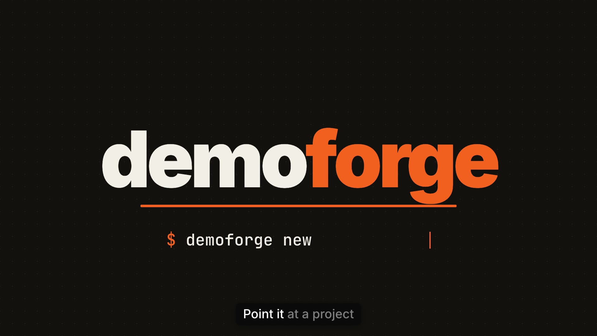

# demoforge

Point it at a repo, get a film. demoforge makes a narrated, scored and captioned demo video of the real product: it films the actual app, designs a narrator from a sentence of text, checks every take, writes the music, cuts it together in HTML and masters it for Slack. All the media renders locally on an Apple Silicon Mac with open models.

[](examples/self-demo/video/renders/demoforge-self-demo.mp4)

**The film above was made by demoforge, from this repo** ([`examples/self-demo`](examples/self-demo)). Its voice, music, captions and cuts all came out of the pipeline below, and it shows its own artifacts: the voice prompt, the takes and their scores, the review page, the build and the check.

## How it works

| Stage | Tool | What it does |
|---|---|---|
| Story | Claude Code + the `demoforge` skill | Reads the target, picks one task and one piece of data to follow, writes `STORYLINES.md`, `SPEC.md` and the narration script |
| Capture | [Playwright](https://github.com/microsoft/playwright) via `capture/recorder.mjs` | Films the real web app at native 2x (2560×1600, ~60 fps); logs every cursor move, click, drag and DOM box; stages slow or outward-facing calls with route mocks |
| Terminal | [VHS](https://github.com/charmbracelet/vhs) | Scripted, real terminal recordings |
| Voice | [VoxCPM2](https://github.com/OpenBMB/VoxCPM) on [mlx-audio](https://github.com/Neywa-Labs/mlx-audio) | Designs a narrator from a text prompt, then reads every line in that voice |
| Checking + timing | [WhisperX](https://github.com/m-bain/whisperX) | Scores every take (character error, pitch, pace) and times every word; the best take per line is picked automatically |
| Music | [ACE-Step 1.5](https://github.com/ace-step/ACE-Step-1.5) | Generates the score; demoforge places it so the lift lands on the reveal and ducks it under every line |
| Edit | [HyperFrames](https://github.com/heygen-com/hyperframes) + [GSAP](https://github.com/greensock/GSAP) via `compose/kit.mjs` | Product-window scenes with camera moves framed on real DOM boxes, a replay of the real cursor, highlights, captions from word timings, sound on every click |
| Review | `demoforge report`, `hyperframes check` and snapshots | A listen-through page for takes and timing, a lint of the film, and stills of every scene and cut |
| Master | ffmpeg | Two-pass loudness normalization to -14 LUFS / -1 dBTP |

## Requirements

- Apple Silicon Mac (voice and music run on MLX), macOS 14 or later
- About 12 GB of disk for models and environments
- Homebrew, Node.js 22+, and [Claude Code](https://claude.com/claude-code) for the automated story and edit

## Install

```bash
git clone https://github.com/cjcsecurity/demoforge.git
cd demoforge
./setup.sh              # ffmpeg, VHS, uv envs, VoxCPM2, WhisperX, ACE-Step, Playwright, Claude Code skill
bin/demoforge doctor    # every row should say ok
```

`setup.sh` links the skill into `~/.claude/skills/demoforge`. Add `bin/` to your `PATH` if you like.

## Make a film

With Claude Code, in any repo:

> Make a 60-second demo video of this repo with demoforge.

The skill runs the loop: story, capture, voice, music, compose, review, render. Or drive it by hand:

```bash
demoforge new films/my-app --target ../my-app   # demo.json, script.json, HyperFrames project
# write script.json, capture/flow.mjs, video/build/build.mjs (see examples/self-demo)
demoforge voice audition films/my-app 4         # design 4 candidate narrators, scored
demoforge voice use films/my-app 2              # keep audition 2 as the voice
demoforge voice lines films/my-app              # read every line in that voice
demoforge voice score films/my-app              # WhisperX checks every take
demoforge voice takes films/my-app 2 s03        # re-roll anything that came out wrong
demoforge voice finalize films/my-app           # best take per line + word timings
demoforge music gen films/my-app                # ACE-Step takes
demoforge capture run films/my-app capture/flow.mjs && demoforge capture encode films/my-app/capture/clips/flow
demoforge build films/my-app && demoforge music bed films/my-app && demoforge build films/my-app
demoforge report films/my-app                   # open films/my-app/report.html and listen
demoforge check films/my-app
demoforge render films/my-app                   # -> films/my-app/video/renders/my-app.mp4
```

## Capturing safely

A demo capture drives a real app, so treat it like a test run against production code:

- Run an isolated instance (throwaway database, demo user, only the credentials the shot needs).
- `s.block(/\/api\/(tickets|email|ai)\//)` first, then `s.mock(...)` the calls you want to stage. Later routes win.
- Say what is staged in the film's delivery note, and blur or trim internal hostnames, index names or customer data before sharing outside your team.

## Layout

```
bin/          demoforge CLI, doctor
capture/      recorder.mjs (Playwright 2x capture library), encode.py (30 fps CFR)
compose/      kit.mjs (HyperFrames scene kit: product windows, cursor, camera, captions, audio map)
pipeline/     voice.py, score.py, score_project.py, finalize.py, music.py, master.sh
report/       report.mjs (review page)
skills/       demoforge/SKILL.md (Claude Code skill)
templates/    files for `demoforge new`
examples/     self-demo: the film above, from script to render
docs/         toolchain.md: the open-source landscape this was picked from
```

## Licences

demoforge is MIT. It calls, and does not include: HyperFrames (Apache-2.0), GSAP (standard no-charge licence), Playwright (Apache-2.0), VHS (MIT), mlx-audio (MIT), VoxCPM2 (Apache-2.0), WhisperX (BSD-2-Clause), ACE-Step 1.5 (MIT), ffmpeg (LGPL/GPL). Sound effects come from the HyperFrames skill library (Pixabay licence) and are copied into each project, not redistributed here. Remotion is deliberately not used: it needs a paid company licence above three employees.
